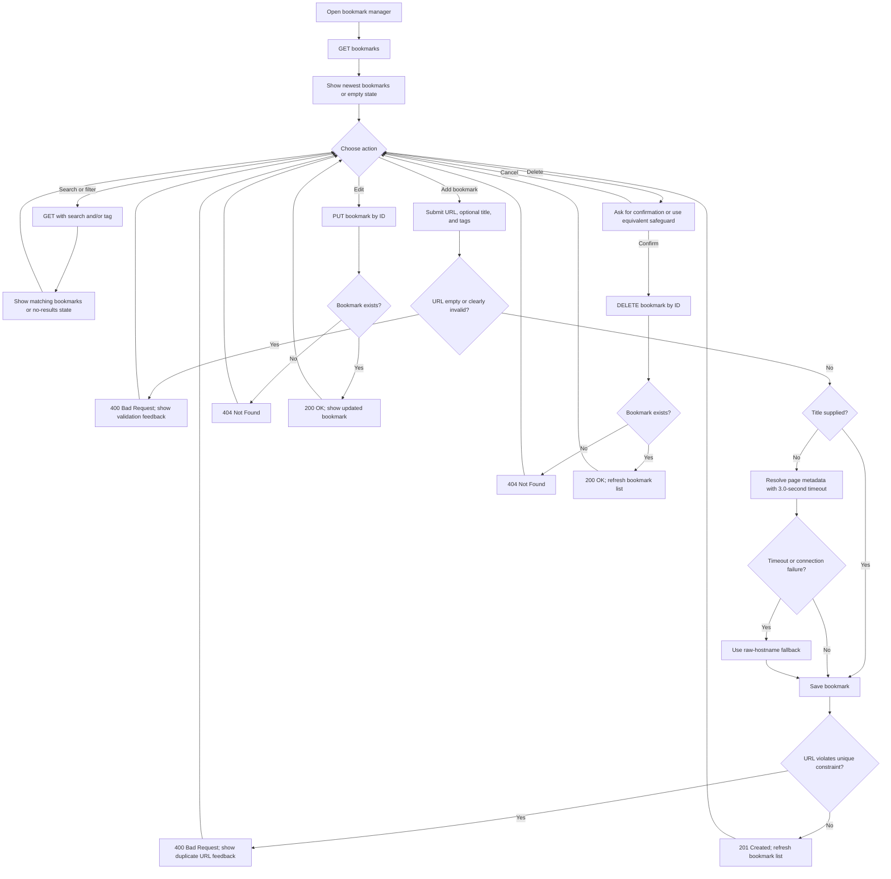

## Problem Understanding

Design a locally running personal bookmark manager, accessed through a browser, for saving URLs, organizing them with tags, and retrieving them by search or tag filter. The design must support adding, listing, editing, and deleting bookmarks; retain data across restarts; and give understandable feedback for invalid input, duplicate submissions, failed title retrieval, and empty results.

The governing architecture is Python 3.11+ with FastAPI, SQLite through SQLAlchemy, and a single-page client using HTML5, vanilla JavaScript, and Tailwind CSS. The product specification defines the user-visible behavior; the technical plan supplies the database tables, API paths/statuses, and title-retrieval fallback used below.

## Requirement Breakdown

- **Bookmark data:** Store a bookmark ID, URL, optional title, and creation timestamp.
- **Tag data:** Store uniquely named tags and associate bookmarks with zero or more tags through a relational link table.
- **Create:** Accept a URL and optional title; when title is omitted, attempt metadata resolution and handle failure gracefully.
- **Read:** List bookmarks newest first. Support `search` and `tag` query parameters on the list endpoint.
- **Update and delete:** Edit a bookmark's URL, title, or tags; provide a reasonable user-interface safeguard before deletion.
- **Persistence:** Use local SQLite via SQLAlchemy so data remains after application restart.
- **Validation and duplicates:** Reject empty or clearly invalid URLs and detect or sensibly handle duplicate URLs.
- **Client states:** Represent empty bookmark lists, no search results, invalid input, duplicate submissions, and metadata-fetch failure clearly.
- **Implementation governance:** Do not implement routes, parsing rules, fields, or behaviors beyond the specification and approved `tasks.md` items. Do not put real-world PII, corporate domains, or tokens in code, tests, or logs.

## User Stories & Acceptance Criteria

- **Save:** A user submits a URL and optional title. If title is omitted, the system attempts to obtain a useful metadata title; if retrieval times out or the connection fails, it uses the raw hostname domain as specified in the technical plan.
- **Tag:** A user can assign one or more tags to a bookmark and later change them.
- **Browse:** A user can retrieve all bookmarks in most-recent-first chronological order.
- **Filter and search:** A user can filter by selected tag or search by title or URL. The list endpoint accepts `tag` and `search` query parameters.
- **Edit:** A user can change a bookmark's URL, title, or tags.
- **Delete:** A user can remove a bookmark after a reasonable confirmation or equivalent safeguard.
- **Persist:** A user's saved bookmarks remain available after the application is stopped and restarted.
- **Understand failures:** Empty or clearly invalid URLs are not saved; duplicate attempts, empty lists, no matches, and metadata retrieval failures are handled in a user-friendly way.

## Edge Cases

- An empty or clearly invalid URL is submitted. The specification requires rejection and understandable feedback; the technical plan assigns `400 Bad Request` to the create route.
- A URL already exists when a create request is submitted. The `bookmarks.url` unique constraint prevents a second row; present a friendly duplicate message rather than a database error.
- A bookmark's URL is edited to one already stored. The unique constraint prevents the conflicting value, but the plan does not define the `PUT` conflict status; settle this in `tasks.md` before implementation.
- A duplicate tag name is encountered. `tags.name` is unique, but the plan defines no tag-specific endpoint or response status; do not infer one.
- A bookmark has no tags, or a selected tag produces no matches.
- A search produces no matches, or the database has no bookmarks.
- Metadata resolution reaches its 3.0-second timeout or the connection fails. Use the specified raw-hostname fallback.
- An update or delete references a missing bookmark. The plan specifies `404 Not Found` for these operations.
- A bookmark is deleted. Apply the planned link-table cascade behavior and keep the UI deletion safeguard in place.

## Non-Functional Requirements

- **Technology:** Python 3.11+ and FastAPI; local SQLite through SQLAlchemy; HTML5, vanilla JavaScript, and Tailwind CSS in a single-page interface.
- **Local browser use:** The application runs locally and is accessible in a browser.
- **Durability:** Persist records in SQLite across application restarts.
- **Bounded metadata lookup:** The technical plan specifies `requests` with a strict 3.0-second timeout and a raw-hostname fallback on timeout or connection failure.
- **Clear error presentation:** Translate expected validation and constraint failures into understandable responses instead of exposing raw database errors.
- **Anonymization:** Code, test files, and logs contain no real-world PII, corporate domains, or tokens.
- **No invented quality targets:** The agreements set no performance, accessibility-conformance, browser-support, or deployment metrics beyond the stated stack and local browser availability.

## Risks, Assumptions & Questions

- **Update collision status:** The plan lists `200 OK` and `404 Not Found` for `PUT`, but does not specify the response when a new URL violates `bookmarks.url` uniqueness. Define the status and response body in an authorized task and reconcile the plan before implementation.
- **Tag uniqueness response:** The database plan makes `tags.name` unique, but neither a tag endpoint nor an HTTP response for a duplicate tag is specified. Define behavior only if required by an approved task.
- **Link-table key:** The plan names both foreign keys and cascade behavior but does not specify a primary key or composite uniqueness rule for `bookmark_tag`. Do not add one without documenting it in an authorized task.
- **Column nullability/defaults:** The plan names the bookmark columns and SQL types but does not define nullability, timestamp defaults, or ID-generation details. Confirm such database details in `tasks.md` rather than assuming them.
- **URL equivalence:** Duplicate detection is required, and the schema marks the stored URL unique, but normalization rules for URL variants are not specified.
- **Create request fields:** The plan names a `BookmarkCreate` schema but does not enumerate its fields. The product requirements establish URL, optional title, and tags as user inputs; define the exact request contract in an authorized task.
- **Scraper fallback scope:** The plan specifies raw-hostname fallback when the 3.0-second timeout is reached or the connection fails. Other failure modes and response parsing details are not specified.
- **Task traceability:** Under the constitution, every implementation line must map to an item in `tasks.md`; design decisions above that remain open must be resolved there before they are implemented.

## Technical Design

### SQLite Relational Schema

The following tables and columns are specified by the technical plan. SQL types and uniqueness/foreign-key constraints are shown as given; unspecified key, nullability, and default behavior is intentionally left open.

| Table | Column | Type | Constraint / purpose |
|---|---|---|---|
| `bookmarks` | `id` | `INTEGER` | Primary key |
| `bookmarks` | `url` | `TEXT` | Unique; a bookmark's stored URL |
| `bookmarks` | `title` | `TEXT` | Bookmark title; optional title input is required by the product specification |
| `bookmarks` | `created_at` | `TIMESTAMP` | Supports most-recent-first chronological listing |
| `tags` | `id` | `INTEGER` | Primary key |
| `tags` | `name` | `TEXT` | Unique tag name |
| `bookmark_tag` | `bookmark_id` | Not specified | Foreign key to `bookmarks`; cascade mapping specified |
| `bookmark_tag` | `tag_id` | Not specified | Foreign key to `tags`; cascade mapping specified |

`bookmarks` and `tags` have a many-to-many relationship represented by `bookmark_tag`. Deleting a referenced parent is specified to cascade through the link mappings. The plan does not state a primary key or composite unique constraint for the link table, so neither is assumed here.

### API Contract and Constraint Responses

| Method and path | Contract from technical plan | Constraint/error presentation |
|---|---|---|
| `POST /api/bookmarks` | Request schema `BookmarkCreate`; `201 Created` or `400 Bad Request` | Return `201 Created` for a saved bookmark. Map invalid input and a duplicate URL detected by the `bookmarks.url` unique constraint to a readable `400 Bad Request` response. A duplicate message should explain that the URL is already saved; do not expose SQLAlchemy/SQLite exception text. |
| `GET /api/bookmarks` | Query parameters `search` (string) and `tag` (string); `200 OK` array | Return the matching list, including an empty array when there are no results; the interface distinguishes an empty collection from a search/filter with no matches. |
| `PUT /api/bookmarks/{id}` | `200 OK` or `404 Not Found` | Return `404 Not Found` when the bookmark ID does not exist and `200 OK` on a successful update. The plan does not state which status to use for a URL uniqueness violation during update; settle that contract in `tasks.md` rather than claiming a status here. |
| `DELETE /api/bookmarks/{id}` | `200 OK` or `404 Not Found` | Return `404 Not Found` for a missing bookmark and `200 OK` when deletion succeeds. The client provides the required confirmation/safeguard before issuing deletion. |

The `tags.name` unique constraint similarly prevents duplicate tag rows. No tag-specific endpoint or status is present in the technical plan, so a user-facing HTTP mapping for that case remains an explicit design question. The `400 Bad Request` mapping above is grounded in the planned create contract; no unlisted HTTP statuses are introduced.

### User Flow

The diagram shows only statuses defined by the plan or, for create validation and URL uniqueness, the plan's `400 Bad Request` create response. URL-collision behavior during `PUT` and duplicate-tag HTTP behavior remain unresolved as noted above.

## AI Interactions

The product specification defines no AI-powered user feature. These evidence blocks document the source basis for this design and do not add AI functionality.

### Evidence E-DESIGN-01

- **Source:** Technical Architecture Plan, Section 1, “Relational Database Topography (SQLite)”.
- **Evidence:** The planned schema names `bookmarks` with `id` (integer primary key), unique `url`, `title`, and `created_at`; `tags` with `id` and unique `name`; and `bookmark_tag` with foreign keys to both parent tables and cascade mappings.
- **Design consequence:** Model bookmarks and tags as relational tables with a many-to-many association. Enforce URL and tag-name uniqueness in SQLite, and do not assume unspecified association keys or column defaults.

### Evidence E-DESIGN-02

- **Source:** Technical Architecture Plan, Section 2, “Interface Invariants (API Specs)”; Product Specification, Section 2.
- **Evidence:** The plan defines create as `POST /api/bookmarks` with `201 Created` / `400 BadRequest`, listing as `GET /api/bookmarks` with `search` and `tag` query parameters and `200 OK`, update as `PUT /api/bookmarks/{id}` with `200 OK` / `404 NotFound`, and delete as `DELETE /api/bookmarks/{id}` with `200 OK` / `404 NotFound`. The product specification requires clear validation and duplicate handling.
- **Design consequence:** Preserve the planned route and status contracts. Translate create-time invalid input and URL uniqueness failures into a user-readable `400` response; do not leak database errors. Treat update-time uniqueness status as unresolved because the plan does not specify it.

### Evidence E-DESIGN-03

- **Source:** Technical Architecture Plan, Section 3, “Scraper Failure Engineering”; Product Specification, Sections 1 and 2; Repository Constitution, Sections 1 and 2.
- **Evidence:** The plan specifies `requests`, a strict 3.0-second timeout, and raw-hostname fallback on timeout or connection failure. The product specification requires optional-title entry and graceful metadata-fetch failure handling. The constitution requires task traceability, anonymization, and the stated Python/FastAPI, SQLite/SQLAlchemy, and HTML5/vanilla-JavaScript/Tailwind stack.
- **Design consequence:** Bound metadata lookup to the specified timeout and use the specified fallback; keep the browser flow within the stated stack; and require open implementation details to be authorized in `tasks.md` without adding ungrounded behavior or personal data.

## Planning Outcome

This design records the schema and API boundaries from the technical plan, connects them to the user-visible bookmark requirements, and calls out unspecified details rather than silently choosing them. In particular, create-time uniqueness maps to the planned `400 Bad Request`, while update-time URL conflicts and duplicate-tag HTTP handling need explicit decisions before implementation.

Before implementation, ensure each behavior and unresolved decision is represented by an authorized `tasks.md` item. Keep the required stack and anonymization invariant intact, and do not add fields, routes, parsing rules, or response contracts that are not approved by the governing documents.
